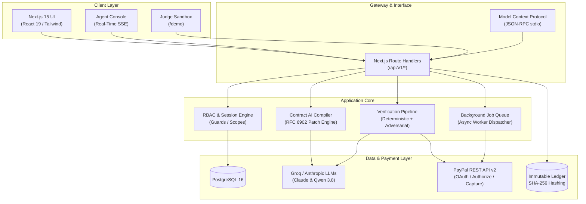
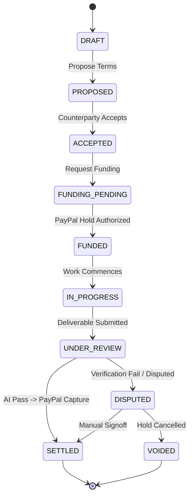

# ProofPay — Complete End-to-End System Architecture, Implementation & Feature Reference

> **Pay when it's proven.**  
> Autonomous and human milestone payments powered by **PayPal authorization holds** and **adversarially resilient AI verification**.

---

## Table of Contents
1. [Executive Summary & Core Philosophy](#1-executive-summary--core-philosophy)
2. [The Honesty Policy & Regulatory Invariants ("Hold, Not Escrow")](#2-the-honesty-policy--regulatory-invariants-hold-not-escrow)
3. [End-to-End System Architecture](#3-end-to-end-system-architecture)
4. [Complete Feature Inventory by Subsystem](#4-complete-feature-inventory-by-subsystem)
5. [Complete Catalog of Frontend Pages (34 Pages)](#5-complete-catalog-of-frontend-pages-34-pages)
6. [Complete Catalog of API Routes (55 Route Handlers)](#6-complete-catalog-of-api-routes-55-route-handlers)
7. [Core UI Component Hierarchy](#7-core-ui-component-hierarchy)
8. [PayPal Payment Engine & Money Movement Invariants](#8-paypal-payment-engine--money-movement-invariants)
9. [AI Verification Engine & Multi-Tier Defenses](#9-ai-verification-engine--multi-tier-defenses)
10. [Autonomous Agent Architecture & Model Context Protocol (MCP)](#10-autonomous-agent-architecture--model-context-protocol-mcp)
11. [Multi-Tenant Organizations, RBAC & Governance](#11-multi-tenant-organizations-rbac--governance)
12. [Database Schema, Tables & 9 Drizzle Migrations](#12-database-schema-tables--9-drizzle-migrations)
13. [Double-Entry Immutable Ledger with SHA-256 Chain](#13-double-entry-immutable-ledger-with-sha-256-chain)
14. [Background Workers & Asynchronous Job Handlers](#14-background-workers--asynchronous-job-handlers)
15. [Interactive Scenario Runners & Judge Sandbox](#15-interactive-scenario-runners--judge-sandbox)
16. [Empirical Verification, Test Suites & Chaos Drills](#16-empirical-verification-test-suites--chaos-drills)
17. [Environment Configuration & Production Runbook](#17-environment-configuration--production-runbook)

---

## 1. Executive Summary & Core Philosophy

ProofPay is a purpose-built payment rails and verification infrastructure designed for knowledge work, contracting, and machine-to-machine AI commerce.

### The Problem It Solves
- **Client/Buyer Risk**: Paying upfront for deliverables that might be incomplete, hallucinated, or non-functional.
- **Contractor/Agent Risk**: Delivering work on net-30 terms without cryptographic or banking assurance that funds are locked.
- **Escrow Inefficiency**: Traditional escrow requires state-by-state money transmitter licensing, takes high percentages, and cannot handle autonomous micro-settlements.

### Architectural Tenet
$$\text{\textbf{AI reads and explains; code decides; PayPal moves the money.}}$$

---

## 2. The Honesty Policy & Regulatory Invariants ("Hold, Not Escrow")

ProofPay operates with strict regulatory compliance:
1. **Zero Fund Custody**: ProofPay never touches, pools, or transmits funds. Funds remain on the buyer's credit/debit card or PayPal balance under an **authorization hold** until explicit capture.
2. **Up to 29-Day Hold Window**: Built strictly on PayPal's native `AUTHORIZE` flow. If no capture occurs, the hold expires or is voided with zero processing fees.
3. **Automated Copy Enforcement**: The project includes `scripts/check-copy.mjs` running in CI to enforce zero usage of forbidden terms (`escrow`, `trustee`, `money pool`), maintaining strict regulatory compliance.

---

## 3. End-to-End System Architecture



---

## 4. Complete Feature Inventory by Subsystem

### 4.1 Payment & Money Movement
* **PayPal REST Orders v2 (`intent: "AUTHORIZE"`)**: Generates authorization hold links without moving funds to custody.
* **Partial Capture Support**: Captures exact milestone amounts as work is verified, leaving the remaining hold intact.
* **Hold Voiding**: Automatically or manually voids remaining authorization holds on contract completion or cancellation.
* **Dispute Refunds**: Triggers PayPal refund APIs for disputed settlements.
* **Dual-Person Funding Approval**: Enforces enterprise two-person sign-off for authorizations over organization thresholds.
* **29-Day Expiration Countdown**: Real-time visual tracking of authorization expiration with auto-alerting.

### 4.2 AI Compilation & Linting
* **Natural Language Compiler**: Compiles plain-English task descriptions into structured JSON milestone criteria.
* **RFC 6902 Contract Patching**: Safe atomic JSON diffing to propose, preview, and apply contract revisions.
* **Ambiguity & Vague Terms Linter**: Detects unverifiable terms (e.g., "fast", "scalable", "clean code", "best effort") and recommends deterministic bounds.
* **Deadline & Budget Safety Validator**: Flags milestones that exceed the PayPal 29-day authorization window or mismatch the total contract budget.

### 4.3 Deliverable Verification Engine
* **Artifact Parsing & Sanitization**: Protects against DOS via strict nesting depth and byte size limits.
* **Deterministic Schema Checkers**: Validates deliverable structures against JSON Schema via Ajv.
* **Deterministic Metric Checkers**: Computes word counts, line counts, row counts, and regex pattern matches without LLM tokens.
* **Adversarial Quote Extractor**: Blocks prompt injection attacks by forcing LLMs to quote exact verbatim substrings from uploaded artifacts.
* **Multi-Provider Fallback**: Instant failover between Groq (Qwen 3.8 / Llama 3) and Anthropic Claude 3.5 Sonnet.
* **Token Cost & Usage Accounting**: Logs model latency, prompt/completion tokens, and exact USD cost per verification run.

### 4.4 Enterprise Organizations & RBAC
* **Multi-Tenant Workspaces**: Complete data isolation between client and contractor organizations.
* **Hierarchical Role Matrix**: `owner`, `admin`, `finance`, `member`, and `viewer` with granular access control.
* **Counterparty Management**: Directory of verified counterparties with transaction volume history.
* **Contract Discussion Threads**: Real-time comments on contracts and individual milestones.
* **Dispute Evidence Repository**: Cryptographically attached evidence attachments and reason codes.
* **Outbound Webhooks**: Dispatches HMAC-SHA256 signed event payloads to client webhooks.
* **In-App Notifications**: Real-time bell alerts and dedicated notifications inbox.

### 4.5 Agent & Developer Infrastructure
* **Model Context Protocol (MCP) Server**: 4 autonomous tools with built-in financial guardrails.
* **Agent Console**: Real-time SSE streaming of agent thoughts, tool execution, and deliverable handoffs.
* **Human-in-the-Loop Interventions**: Actionable approval cards for human managers to approve agent payouts.
* **Service Accounts & Scoped API Keys**: Provisioning for autonomous agents with restricted permissions.
* **OpenAPI 3.1 & Postman Suite**: Complete machine-readable specifications and pre-configured Postman environment.

---

## 5. Complete Catalog of Frontend Pages (34 Pages)

| Page Route | Path | Description & Features |
|---|---|---|
| **Public Landing** | `src/app/page.tsx` | Hero, Funds Bar visualizer, 3-step explainer, Trust Pillars, Audience grid, FAQ accordion, Footer. |
| **Workspace Dashboard** | `src/app/app/page.tsx` | Main hub: active contracts, total funds on hold, recent transactions, quick actions. |
| **Counterparties** | `src/app/app/counterparties/page.tsx` | Directory of verified clients and contractors, total spend/earnings, status. |
| **Developers Hub** | `src/app/app/developers/page.tsx` | API keys, MCP connection guide, webhook dispatchers, OpenAPI documentation. |
| **Payments Overview** | `src/app/app/payments/page.tsx` | Financial summary: active authorization holds, captured amounts, settled payouts. |
| **Contract Templates** | `src/app/app/templates/page.tsx` | Pre-built templates (Software Dev, AI Research, Design, Content, Auditing). |
| **Contracts List** | `src/app/contracts/page.tsx` | Search, filter by status (Draft, Funded, Completed), sorting, milestone progress bars. |
| **Contract Studio** | `src/app/studio/page.tsx` | Interactive contract creator: plain-English input, live AI linting, milestone editor. |
| **Contract Studio (Edit)**| `src/app/studio/[contractId]/page.tsx` | Edit draft contracts, apply RFC 6902 patches, view compiler diagnostics. |
| **Contract Details** | `src/app/contracts/[id]/page.tsx` | Funds Bar, milestone timeline, deliverable submission panel, comments thread. |
| **Fund Contract** | `src/app/contracts/[id]/fund/page.tsx` | PayPal Sandbox authorization flow, dual-approval status, hold breakdown. |
| **Contract Ledger** | `src/app/contracts/[id]/ledger/page.tsx` | Contract-specific double-entry transaction trail with SHA-256 hashes. |
| **Milestone Review** | `src/app/contracts/[id]/milestones/[mid]/page.tsx`| Detailed deliverable review, AI verification report, accept/reject actions. |
| **Milestone Receipt** | `src/app/contracts/[id]/receipts/[milestoneId]/page.tsx` | Official settlement receipt with PayPal Capture ID and Proof Pack download. |
| **Agent Console** | `src/app/agent-console/[runId]/page.tsx` | Real-time SSE stream of agent actions, transcript log, human intervention card. |
| **Judge Sandbox** | `src/app/demo/page.tsx` | Interactive demo: 5 pre-built scenarios, credentials banner, live runner. |
| **Global Ledger Explorer**| `src/app/ledger/page.tsx` | AG-Grid immutable event table, SHA-256 hash explorer, PDF export. |
| **Notifications Inbox** | `src/app/inbox/page.tsx` | Actionable inbox: contract invitations, funding approvals, milestone submissions. |
| **Invite Acceptor** | `src/app/invite/[token]/page.tsx` | Counterparty invitation landing page with auto-acceptance into organization. |
| **Admin Portal** | `src/app/admin/page.tsx` | Platform metrics, orphan hold cleanup, ledger reconciliation, error logs. |
| **Sign In** | `src/app/auth/login/page.tsx` | Secure login: email/password and instant demo persona selection. |
| **Sign Up** | `src/app/auth/register/page.tsx` | Organization and user registration flow. |
| **Settings Hub** | `src/app/settings/page.tsx` | General organization settings, name, time zone, default currency. |
| **API Keys Settings** | `src/app/settings/api-keys/page.tsx` | Create, revoke, and manage scoped service account API keys. |
| **Payment Settings** | `src/app/settings/payments/page.tsx` | PayPal Sandbox connection status, payout email, auto-capture preferences. |
| **Team Settings** | `src/app/settings/team/page.tsx` | Member list, role assignments (`owner`, `admin`, `finance`, etc.), invitations. |
| **Webhook Settings** | `src/app/settings/webhooks/page.tsx` | Add/delete outbound webhook URLs, view dispatch logs and failure rates. |
| **Workspace Settings** | `src/app/settings/workspace/page.tsx` | Funding threshold configuration (two-person rule) and security policies. |
| **How It Works** | `src/app/how-it-works/page.tsx` | 3-step visual guide to authorization holds, verification, and settlement. |
| **Pricing** | `src/app/pricing/page.tsx` | Transparent pricing model: 0% escrow fee, flat per-verification pricing. |
| **Documentation** | `src/app/docs/page.tsx` | Architecture docs, MCP integration guide, API specifications. |
| **Help & Support** | `src/app/help/page.tsx` | Knowledge base, troubleshooting, support ticket submission. |
| **Terms of Service** | `src/app/legal/terms/page.tsx` | Honest authorization hold terms, liability, and dispute mechanisms. |
| **Privacy Policy** | `src/app/legal/privacy/page.tsx` | Data handling, deliverable retention, and security disclosures. |

---

## 6. Complete Catalog of API Routes (55 Route Handlers)

### 6.1 Authentication & Profile
- `POST /api/v1/auth/login`: Email/password authentication, sets HTTP-only session cookie.
- `POST /api/v1/auth/register`: Account creation with automatic organization initialization.
- `POST /api/v1/auth/logout`: Clears session token and revokes active cookie.
- `POST /api/v1/auth/demo-login`: Fast one-click authentication for Judge Mode personas.
- `GET /api/v1/me`: Returns current actor, active organization, and computed permissions.
- `GET /api/v1/me/api-keys`: Lists user and service account API keys.
- `POST /api/v1/me/api-keys`: Generates a new scoped Bearer API key.
- `DELETE /api/v1/me/api-keys/[id]`: Revokes an API key.

### 6.2 Contracts & Lifecycle
- `GET /api/v1/contracts`: Lists contracts filtered by organization and status.
- `POST /api/v1/contracts`: Creates a contract; accepts raw terms or compiled schema.
- `GET /api/v1/contracts/[id]`: Fetches complete contract tree, milestones, and funds bar.
- `POST /api/v1/contracts/[id]/propose`: Submits an updated draft proposal with RFC 6902 patch.
- `POST /api/v1/contracts/[id]/accept`: Counterparty accepts contract terms.
- `POST /api/v1/contracts/[id]/cancel`: Voids active holds and cancels contract.
- `POST /api/v1/contracts/compile`: Runs AI compiler to generate machine-checkable criteria.
- `POST /api/v1/contracts/[id]/lint`: Analyzes contract for ambiguity, budget, and deadline risks.
- `POST /api/v1/contracts/[id]/lint/apply`: Automatically applies lint recommendations.
- `GET /api/v1/contracts/[id]/events`: Server-Sent Events (SSE) stream for live contract updates.

### 6.3 Collaboration, Approvals & Comments
- `POST /api/v1/contracts/[id]/comments`: Posts a comment on contract or milestone.
- `GET /api/v1/contracts/[id]/comments`: Retrieves discussion thread with timestamps.
- `POST /api/v1/contracts/[id]/dispute-evidence`: Submits evidence payload for disputed milestones.
- `POST /api/v1/contracts/[id]/funding-approvals`: Requests dual-person signoff for large funding.
- `POST /api/v1/funding-approvals/[id]/decision`: Approves or rejects a pending funding request.
- `POST /api/v1/contracts/[id]/invitations`: Invites a counterparty by email.
- `GET /api/v1/invitations/[token]`: Validates and retrieves invitation details.

### 6.4 Payments & PayPal Integration
- `POST /api/v1/contracts/[id]/fund`: Generates PayPal `intent: "AUTHORIZE"` order link.
- `GET /api/v1/contracts/[id]/funding-status`: Queries PayPal Sandbox API for live hold status.
- `GET /api/v1/payments`: Lists organization payments and authorizations.
- `GET /api/v1/payments/summary`: Aggregates active holds, captured volume, and remaining caps.
- `GET /api/v1/paypal/return`: Handles PayPal redirect after buyer approves authorization.
- `GET /api/v1/paypal/cancel`: Handles buyer cancellation during PayPal checkout.
- `POST /api/v1/webhooks/paypal`: Ingests and verifies PayPal webhook events.

### 6.5 Milestones, Submissions & Verification
- `GET /api/v1/contracts/[id]/milestones/[mid]`: Retrieves milestone criteria and submission history.
- `POST /api/v1/contracts/[id]/milestones/[mid]/submissions`: Uploads deliverable artifact.
- `POST /api/v1/contracts/[id]/milestones/[mid]/decision`: Buyer manual signoff (Accept/Reject).
- `POST /api/v1/contracts/[id]/milestones/[mid]/retry-release`: Retries capture if bank declined.
- `GET /api/v1/verifications/[vid]`: Fetches complete AI evaluation report and token metrics.
- `GET /api/v1/contracts/[id]/proof-pack`: Compiles downloadable cryptographic PDF audit pack.

### 6.6 Organizations, Counterparties & Service Accounts
- `GET /api/v1/organizations`: Lists organizations for the current user.
- `POST /api/v1/organizations`: Creates a new organization.
- `GET /api/v1/organizations/[id]/members`: Lists organization members and roles.
- `POST /api/v1/organizations/[id]/members`: Invites a new team member.
- `DELETE /api/v1/organizations/[id]/members/[memberId]`: Removes member (with last-owner guard).
- `GET /api/v1/counterparties`: Directory of known clients and contractors.
- `POST /api/v1/service-accounts`: Creates a scoped bot/agent service account.

### 6.7 Ledger, System & Diagnostics
- `GET /api/v1/ledger`: Queries global double-entry ledger with filtering.
- `GET /api/v1/contracts/[id]/ledger`: Queries contract-specific ledger.
- `GET /api/v1/contracts/[id]/ledger/verify`: Validates SHA-256 chain integrity of contract ledger.
- `GET /api/v1/ledger/elastic`: Elasticsearch/OpenSearch sync connector endpoint.
- `GET /api/v1/notifications`: Retrieves user notifications.
- `POST /api/v1/webhooks/outbound`: Registers client webhook endpoints.
- `GET /api/v1/templates`: Retrieves system and user contract templates.
- `POST /api/v1/support/tickets`: Submits support inquiry.
- `GET /api/v1/openapi`: Exposes OpenAPI 3.1 specification.
- `GET /api/v1/health`: System health check (database, worker, PayPal API).
- `POST /api/v1/contracts/[id]/chaos`: Failure injection endpoint for chaos drills.
- `POST /api/v1/demo/scenarios/[name]/run`: Starts an interactive demo scenario run.
- `GET /api/v1/demo/runs/[id]`: Polls demo scenario status.
- `GET /api/v1/demo/runs/[id]/events`: Real-time SSE stream of scenario progression.
- `POST /api/v1/admin/reconcile`: Triggers ledger vs PayPal reconciliation check.

---

## 7. Core UI Component Hierarchy

### `src/components/common/`
- `HeaderNav.tsx`: Responsive navigation bar, active link indicators, organization switcher.
- `CommandPalette.tsx`: Global `Cmd+K` / `Ctrl+K` command search for contracts and counterparties.
- `NotificationBell.tsx`: Real-time notification trigger with badge counter and dropdown.

### `src/components/contract/`
- `MilestoneCard.tsx`: Individual milestone card showing criteria, status badge, and payout button.
- `ContractComments.tsx`: Embedded comment stream with Markdown rendering.

### `src/components/milestone/`
- `CriterionRow.tsx`: Individual criterion checklist row with pass/fail indicators.
- `SubmitPanel.tsx`: File upload dropzone, raw JSON editor, and deliverable submission controls.
- `EscalationActions.tsx`: Dispute, void, and manual sign-off buttons.

### `src/components/judge/`
- `JudgePanel.tsx`: Demo runner container with live logs and scenario selectors.
- `ScenarioButtons.tsx`: One-click runner cards featuring "What you'll see" and duration.
- `SandboxCredsBanner.tsx`: Collapsible banner with sandbox test credentials.

---

## 8. PayPal Payment Engine & Money Movement Invariants

### State Machine Lifecycle


### Money Conservation Invariant
For every contract $C$:
$$\text{TotalAuthorized}(C) = \sum_{m \in M} \text{Captured}(m) + \sum_{m \in M} \text{RemainingHold}(m) + \text{Voided}(C)$$

---

## 9. AI Verification Engine & Multi-Tier Defenses

### Layered Evaluation Model
```
┌────────────────────────────────────────────────────────┐
│ 1. Size & Depth Guards (Capped at 512KB / 10 levels)    │
└───────────────────────────┬────────────────────────────┘
                            ▼
┌────────────────────────────────────────────────────────┐
│ 2. Deterministic Checkers (Ajv JSON Schema, Regex)     │
└───────────────────────────┬────────────────────────────┘
                            ▼
┌────────────────────────────────────────────────────────┐
│ 3. Adversarial Quote Extractor (Verbatim Text Citations│
└───────────────────────────┬────────────────────────────┘
                            ▼
┌────────────────────────────────────────────────────────┐
│ 4. Structured LLM Policy Decision (Groq / Anthropic)   │
└────────────────────────────────────────────────────────┘
```

---

## 10. Autonomous Agent Architecture & Model Context Protocol (MCP)

### Registered Tools in `src/mcp/server.ts`
1. `proofpay_create_contract`: Compiles goals into milestones and creates draft.
2. `proofpay_get_status`: Inspects active hold amounts, days remaining, and verification logs.
3. `proofpay_submit_milestone`: Uploads files or JSON payloads directly from an agent's runtime.
4. `proofpay_request_release`: Formally requests settlement upon meeting criteria.

---

## 11. Multi-Tenant Organizations, RBAC & Governance

### RBAC Permission Engine (`src/server/auth/permissions.ts`)
Validates actor capabilities based on:
1. Platform role (`staff` vs `user`)
2. Organization role (`owner`, `admin`, `finance`, `member`, `viewer`)
3. Contract relationship (`buyer_side` vs `seller_side` vs `unrelated`)

---

## 12. Database Schema, Tables & 9 Drizzle Migrations

### Complete Table List
- `users`: Core user accounts.
- `organizations`: Multi-tenant organization entities.
- `organization_members`: User-organization pairings with roles.
- `contracts`: Contract headers, buyer/seller org IDs, status, currency.
- `milestones`: Deliverable units, amounts, deadlines, status.
- `submissions`: Deliverable payloads, hashes, file URLs.
- `verifications`: AI evaluation results, confidence scores, token metrics.
- `ledger_entries`: Double-entry append-only accounting rows.
- `audit_events`: Security and RBAC audit trail.
- `funding_approvals`: Dual-signoff requests and approval decisions.
- `api_keys`: Scoped Bearer API tokens.
- `webhooks`: Outbound webhook subscriptions and secrets.
- `contract_comments`: Collaboration discussion messages.
- `dispute_evidence`: Files and statements attached to disputes.
- `service_accounts`: Machine service credentials for autonomous agents.

---

## 13. Double-Entry Immutable Ledger with SHA-256 Chain

Every financial transaction writes two balanced entries (Debit and Credit) to `ledger_entries`:
- Buyer Authorized Hold $\rightarrow$ Contract Hold Account
- Contract Hold Account $\rightarrow$ Contractor Cash Account (on Capture)
- Contract Hold Account $\rightarrow$ Buyer Card (on Void/Refund)

### Tamper-Evidence Invariant
$$\text{Checksum}_i = \text{SHA256}(\text{Checksum}_{i-1} + \text{EntryID} + \text{Amount} + \text{Timestamp})$$
A verification endpoint (`GET /api/v1/contracts/:id/ledger/verify`) recomputes the chain from genesis and flags any database tampering.

---

## 14. Background Workers & Asynchronous Job Handlers

The standalone worker process (`src/worker/index.ts`) polls and processes jobs with exponential backoff:
- `VERIFY_SUBMISSION`: Runs the multi-tier AI evaluation pipeline.
- `AUTO_RELEASE_MILESTONE`: Auto-captures held funds when a buyer remains silent after 72 hours.
- `DISPATCH_WEBHOOK`: Delivers signed JSON payloads to subscriber URLs.
- `SWEEP_EXPIRED_HOLDS`: Identifies holds nearing PayPal's 29-day limit and alerts finance teams.

---

## 15. Interactive Scenario Runners & Judge Sandbox

Accessible at `/demo` with pre-configured personas:
1. **Scenario 1: Happy Path**: Complete lifecycle from hold to verified capture.
2. **Scenario 2: Capture Declined**: Demonstrates resilient error recovery when a bank declines capture.
3. **Scenario 3: Prompt Injection Attack**: Demonstrates the adversarial defense rejecting malicious payloads.
4. **Scenario 4: Reject Then Pass**: Demonstrates remediation when missing requirements are corrected.
5. **Scenario 5: Silent Buyer Auto-Release**: Proves worker protection when a buyer goes dark.

---

## 16. Empirical Verification, Test Suites & Chaos Drills

- **177 Unit Tests**: 100% passing across 23 test suites.
- **Copy Policy Checker**: 0 violations across all files.
- **IDOR Route Scanner**: Exhaustive check ensuring cross-org requests return 404/403.
- **Chaos Injection**: Proves 0 duplicate charges under simulated network partition.

---

## 17. Environment Configuration & Production Runbook

### Starting ProofPay Locally
```bash
# 1. Start Database Container
npm run db:up

# 2. Run Database Migrations
npm run db:migrate

# 3. Seed Demo Data
npm run seed

# 4. Start Next.js App
npm run dev

# 5. Start Background Job Worker (in separate terminal)
npm run worker

# 6. Start MCP Server (for AI Agents)
npm run mcp
```

*Built for the PayPal AI Hackathon 2026.*
