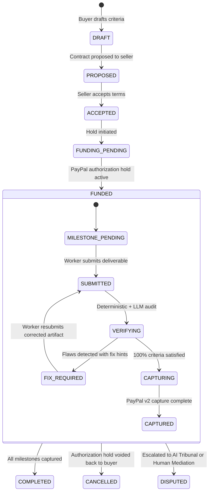

# ProofPay Unified Specification & Architecture (SPEC.md)

> **Authority:** This document consolidates and supersedes all fragmented historical specifications across `docs/v2/`, `docs/spec/`, and `docs/plan/`.  
> Per `docs/WINNING-PLAYBOOK.md` §10, this is the authoritative technical reference for ProofPay's data models, state machines, API routes, security posture, and zero-custody financial invariants.

---

## 1. System Glossary & Vocabulary (Single Source of Truth)

### Financial Model:
- **Custody Invariant:** ProofPay **never** holds, pools, or transmits funds.
- **PayPal Authorization Hold:** Buyer funds remain in the buyer's PayPal account under an authorization hold (28-day validity window). ProofPay triggers partial captures (`is_final_capture: false`) or voids via PayPal v2 API.
- **Rejection vs Dispute:** A milestone rejection by the AI verification engine is **not** a dispute. It provides structured fix hints (`src/server/verify/fix-hints.ts`) allowing the worker to resubmit. A formal dispute is only triggered upon irreconcilable impasse or manual human escalation.

### Roles & Access Control:
- **Owner:** Full organization ownership, legal signatory, billing management, deletion.
- **Admin:** Team management, API key generation, contract approvals.
- **Finance:** Two-person rule funding signatory, PayPal account linkage, payout reconciliation.
- **Member:** Create and draft contracts, submit deliverables.
- **Viewer:** Read-only access to contracts and audit ledger.
- **Service Account (Agent):** Scoped API keys with machine mandates (cannot approve funding, cancel contracts, or override verification decisions).

### Canonical State Machine:

---

## 2. API Routes & Endpoint Directory

All endpoints are wrapped with `apiHandler` enforcing:
- Request ID tracing (`x-request-id`)
- Strict authentication & RBAC
- Durable rate limiting (Upstash Redis with in-memory fallback)
- Nonce CSP headers
- IDOR isolation (unauthorized access returns `404 NOT_FOUND` rather than `403` to prevent resource enumeration)

### Flagship Evaluation & Interactive Testbench Endpoints:
- `GET /api/v1/demo/express` — Pre-authorized judge pool status
- `POST /api/v1/demo/express` — 1-click &le; 90-second contract claim and real PayPal sandbox capture
- `GET /api/v1/demo/mcp` — Model Context Protocol tool schema definitions and guardrails
- `POST /api/v1/demo/mcp` — In-browser JSON-RPC 2.0 tool execution testbench
- `GET /api/v1/demo/tribunal` — Multi-agent dispute scenarios and governance rules
- `POST /api/v1/demo/tribunal` — Automated arbitration debate execution and binding verdict generator
- `GET /api/v1/demo/agent-wallet` — PayPal autonomous agent session spend policy
- `POST /api/v1/demo/agent-wallet` — Dynamic policy evaluator blocking adversarial spend attempts
- `GET /api/v1/metrics` — OpenMetrics / Prometheus scrape endpoint for telemetry and audit latencies

---

## 3. Cryptographic Proof Pack & Offline Verification

ProofPay guarantees that neither party needs to trust ProofPay servers to verify contract fulfillment:

1. **Deterministic Canonicalization:** Payloads are serialized lexicographically using `canonicalize()` with zero whitespace.
2. **SHA-256 Merkle Chain:** Every ledger event seals the previous hash, sequence number, actor type, timestamp, and payload.
3. **RFC 3161 Timestamping:** Checkpoint root hashes are digitally signed and timestamped.
4. **Client-Side WebCrypto Verifier (`/verify`):** Runs purely inside the browser runtime using `crypto.subtle.digest` with zero server requests.
5. **Certified Dispute Dossier:** Generates printable, PDF-ready compliance documentation for PayPal Merchant Dispute Resolution.

---

## 4. Document Supersedes Matrix

| Historical Document | Status | Authoritative Replacement |
| :--- | :--- | :--- |
| `docs/v2/PROOFPAY-WINNING-PLAN.md` | **Superseded** | `docs/WINNING-PLAYBOOK.md` & `docs/SPEC.md` |
| `docs/v2/PROOFPAY-FULL-AUDIT-AND-IMPROVEMENTS.md` | **Superseded** | `docs/WINNING-PLAYBOOK.md` & `docs/SPEC.md` |
| `docs/v2/01-NEXT-LEVEL-STRATEGY.md` | **Superseded** | `docs/WINNING-PLAYBOOK.md` |
| `docs/v2/04-ENGINEER-2-SPEC-AI-PRODUCT.md` | **Superseded** | Fully implemented in `src/` (AIP-1 through AIP-14) |
| `docs/v2/01-NEW-FEATURES-SECURITY-AI-PRODUCT.md` | **Superseded** | Fully implemented in `src/` (PLAT-1 through PLAT-12) |

