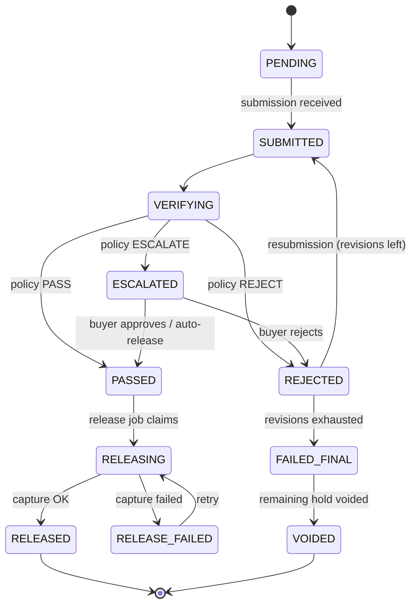

# ProofPay — Architecture

> Companion files: `prd.md` (requirements), `data-model.md`, `api-spec.md`, `ai-pipeline.md`, `paypal-integration.md`.

## 1. Architecture pattern and why

**A modular monolith in one TypeScript codebase, deployed as three processes** (web, worker, MCP) sharing one Postgres database.

Why, given 10 days and 4 people:
- One repo, one language, one set of types shared by UI, API, worker, and agents. No service contracts to keep in sync.
- Money movement and verification need **crash-safe, ordered, retryable** execution. A **transactional outbox** (the `jobs` table in Postgres, claimed with `FOR UPDATE SKIP LOCKED`) gives that without adding Redis/queues.
- The three processes isolate failure: the web app never makes PayPal capture calls inline; the worker does. If the worker restarts mid-capture, the idempotency key plus reconciliation makes it safe.

## 2. System diagram

```mermaid
flowchart LR
  subgraph Clients
    U[Buyer / Seller browser]
    A[Buyer agent + Worker agent<br/>REST or MCP]
    J[Judge Mode UI]
  end

  subgraph Render
    W[Web process<br/>Next.js 15 App Router<br/>UI + /api/v1 route handlers]
    K[Worker process<br/>jobs poller]
    M[MCP server process<br/>stdio/HTTP, six tools]
    DB[(Postgres 16)]
  end

  PP[(PayPal Sandbox<br/>Orders v2, Payments v2,<br/>Webhooks)]
  LLM[(Anthropic API<br/>Claude)]

  U -->|HTTPS| W
  J -->|HTTPS| W
  A -->|REST + API key| W
  A -->|MCP tools| M
  M -->|REST + API key| W
  W <-->|SQL| DB
  K <-->|SQL, jobs outbox| DB
  W -->|create order / authorize| PP
  K -->|capture / void / reauthorize / refund| PP
  PP -->|signed webhooks| W
  K -->|compile / lint / verify| LLM
  W -->|compile / lint (sync)| LLM
```

**Direction-of-data rules**
1. Browser/agent → Web (REST). Web writes DB and enqueues jobs.
2. Worker reads jobs from DB, calls PayPal (capture/void/reauth/refund) and the LLM (verification), writes results and ledger events.
3. PayPal → Web via webhooks; the web process verifies the signature, stores the raw event, and enqueues reconciliation if needed.
4. Compile and lint run **synchronously in the web process** (user is waiting). Verification and release run **asynchronously in the worker**.

## 3. Components

| Component | Responsibility | Talks to | Code location |
|---|---|---|---|
| Web UI | Studio, Fund, Timeline, Verification Report, Ledger, Judge Mode, Agent Console | Web API | `src/app/` |
| API layer | Thin route handlers: auth, validation (Zod), call services, map errors | Services | `src/app/api/v1/` |
| Contract service | Compile, lint, edit, propose, accept, hash | LLM adapter, DB | `src/server/contracts/` |
| Linter | Deterministic rules + AI suggestions | LLM adapter | `src/server/contracts/lint/` |
| Verification engine | Stages 1–4, caching, evidence check | LLM adapter, DB | `src/server/verify/` |
| Policy engine | **Pure function** `decide()`; no I/O | none | `src/server/verify/policy.ts` |
| Release service | The **only** module allowed to call PayPal capture/void/refund | PayPal adapter | `src/server/release/` |
| PayPal adapter | Typed REST client, OAuth token cache, idempotency, retries, chaos header | PayPal | `src/server/paypal/` |
| LLM adapter | The **only** module allowed to call Anthropic: budget, cache, logging, retries | Anthropic | `src/server/ai/llm.ts` |
| Ledger service | Append hash-chained events under an advisory lock; verify chain; Proof Pack | DB | `src/server/ledger/` |
| Jobs | Outbox table, claim/execute/retry; job handlers | DB, services | `src/server/jobs/`, `src/worker/` |
| Demo runner | Scenarios, buyer/worker agents, SSE feed | REST API | `src/demo/` |
| MCP server | Six tools mapping to REST | REST API | `src/mcp/` |

**Layering rules (enforced by lint rule / code review)**
- Route handlers → services → repositories (Drizzle). Routes never import the PayPal or LLM adapters directly.
- `release/` is the only importer of `paypal/capture.ts`, `void.ts`, `refund.ts`.
- `ai/llm.ts` is the only importer of the Anthropic SDK.
- `policy.ts` imports nothing from `ai/`, `paypal/`, or `db/`.

## 4. Tech stack (with reasons)

| Layer | Choice | Why |
|---|---|---|
| Language | TypeScript 5, Node 20 | Shared types across UI/API/worker; fastest for a 4-person team |
| Web framework | Next.js 15 (App Router), React 19 | One deployable for UI + API; server components for fast pages |
| Styling/UI | Tailwind CSS + shadcn/ui + lucide-react | Fast, consistent, accessible primitives; custom tokens give a distinct look |
| Ledger grid | AG Grid Community (`ag-grid-react`) | Sponsor tool, fits the ledger. Note: master/detail is Enterprise-only, so use a side drawer |
| Validation | Zod | Single source for request, DB-JSON, and LLM-output schemas |
| DB | Postgres 16 | Transactions, advisory locks, `SKIP LOCKED`, triggers for ledger immutability |
| ORM/migrations | Drizzle ORM + drizzle-kit, `postgres` driver | SQL-near, typed, simple migrations |
| JSON checks | Ajv (JSON Schema draft 2020-12) | Industry-standard validator for `json_schema` check |
| AI | `@anthropic-ai/sdk`; models via env (`ANTHROPIC_MODEL` default `claude-sonnet-5-5`, `ANTHROPIC_MODEL_FAST` default `claude-haiku-5-5`; confirm strings in Anthropic docs) | Forced tool-use for strict JSON outputs |
| PayPal | Direct REST via `fetch` (typed wrapper) | Full control of authorize/capture/void/reauthorize/refund and headers; toolkit not required |
| Jobs | Postgres `jobs` table + `src/worker/index.ts` poller | No Redis; transactional enqueue |
| Realtime | Server-Sent Events + 5 s polling fallback | Simple, proxy-friendly, enough for timelines and the Agent Console |
| MCP | `@modelcontextprotocol/sdk` | PayPal's own agentic direction; agent story |
| PDF | `pdfkit` | Simple server-side Proof Pack PDF |
| Logging | `pino` (JSON) with `request_id` | Debuggable during the demo |
| Tests | Vitest, MSW (HTTP mocks), Playwright | See `testing.md` |
| Hosting | Render (web service, background worker, Postgres) | Sponsor; one place; credits |
| CI | GitHub Actions | Typecheck, lint, unit, build |

## 5. The most important flow: milestone submission → verified release

```mermaid
sequenceDiagram
  autonumber
  participant S as Seller (human/agent)
  participant W as Web API
  participant DB as Postgres
  participant K as Worker
  participant L as LLM (Claude)
  participant P as PayPal
  S->>W: POST /contracts/{id}/milestones/m1/submissions
  W->>DB: TX1: insert submission(sha256), milestone SUBMITTED→VERIFYING,<br/>ledger SUBMISSION_RECEIVED, enqueue VERIFY_SUBMISSION
  W-->>S: 202 {submission_id, verification_id}
  K->>DB: claim VERIFY_SUBMISSION (SKIP LOCKED)
  K->>K: Stage 1 deterministic checks
  K->>L: Stage 2 rubric verify (forced tool schema, temp 0)
  K->>K: verify each evidence quote is a substring of the artifact
  K->>L: Stage 3 adversarial pass (fast model)
  K->>K: Stage 4 policy.decide() → PASS | REJECT | ESCALATE
  K->>DB: TX2: save verification, update milestone, ledger VERIFICATION_COMPLETED + MILESTONE_*,<br/>if PASS: status PASSED + enqueue RELEASE_MILESTONE
  K->>DB: claim RELEASE_MILESTONE; TX3: status PASSED→RELEASING (guard), ledger CAPTURE_REQUESTED
  K->>P: POST /v2/payments/authorizations/{id}/capture<br/>PayPal-Request-Id: pp:{contract}:{milestone}:capture:{n}
  P-->>K: 201 COMPLETED (or declined)
  K->>DB: TX4: RELEASING→RELEASED (or RELEASE_FAILED), capture_id, ledger CAPTURE_COMPLETED/FAILED
  P-->>W: webhook PAYMENT.CAPTURE.COMPLETED (verified, idempotent; confirms state)
  W-->>S: SSE event → timeline updates
```

**Transaction boundaries.** PayPal is **never called inside a DB transaction**. State is moved to `RELEASING` first (committed), then PayPal is called with a deterministic idempotency key, then the result is committed. A crash between steps leaves `RELEASING`, which the reconcile job resolves by asking PayPal what happened.

## 6. State machines



Contract status: `DRAFT → PROPOSED → ACCEPTED → FUNDING → FUNDED → IN_PROGRESS → COMPLETED`; terminal alternates `FAILED`, `CANCELLED`, `EXPIRED`. Full transition tables live in `data-model.md` §6 and are enforced by `src/server/contracts/transitions.ts`.

## 7. Concurrency and consistency

- **Per-contract advisory lock** (`pg_advisory_xact_lock(hashtextextended(contract_id::text, 0))`) around every state transition and ledger append. `UNIQUE(contract_id, seq)` on the ledger is the backstop.
- **Job claiming**: `UPDATE jobs SET status='RUNNING', locked_at=now(), attempts=attempts+1 WHERE id = (SELECT id FROM jobs WHERE status='PENDING' AND run_at <= now() ORDER BY run_at FOR UPDATE SKIP LOCKED LIMIT 1) RETURNING *`.
- **Idempotency**: HTTP `Idempotency-Key` on fund/submit/decision; PayPal `PayPal-Request-Id` on all PayPal POSTs; `paypal_events.event_id UNIQUE` for webhooks.
- **Verification cache**: key = `sha256(artifact) + criteria_hash + prompt_version + model`; a hit skips LLM calls.

## 8. Key trade-offs

| Decision | Chosen | Alternative | Why chosen |
|---|---|---|---|
| Hold mechanism | PayPal `AUTHORIZE` + partial captures | Capture upfront and refund on failure | Buyer isn't charged until proven; matches the pitch; uses deeper PayPal APIs |
| Who decides | Deterministic policy engine over LLM signals | LLM returns the final verdict | Safety and explainability; injection can't flip status |
| Queue | Postgres outbox | Redis + BullMQ | One fewer service; transactional enqueue; adequate scale |
| Deployables | Modular monolith, 3 processes | Microservices | Time box |
| Realtime | SSE + polling | WebSockets | Simpler, works through Render's proxy |
| Artifacts | Text in Postgres (≤ 1 MB) | S3-style blob store | No extra infra; fits JSON/text deliverables |
| Auth | Signed-cookie demo personas + API keys | Full OAuth/Auth.js | Time; judge-friendly; documented upgrade path |
| Seller payee | Single sandbox merchant | PayPal marketplace/partner payee | Avoids multi-party approval complexity |

## 9. What changes for real production scale

Replace demo personas with real auth and KYC; move to PayPal Commerce Platform/partner flows so multiple sellers can be payees; replace Postgres jobs with a managed queue and add dead-letter handling; store artifacts in object storage with malware scanning and per-tenant encryption; add rate limiting at the edge; move verification to isolated workers with per-tenant budgets; add legal review of the "hold vs escrow" language and payment-regulation analysis; add observability (traces, SLOs) and a formal incident process; run the verifier evaluation continuously against production traffic with human-labeled samples.

## 10. Assumptions

| # | Assumption |
|---|---|
| AR-1 | One web instance and one worker instance suffice for judging traffic (< 50 concurrent users). |
| AR-2 | Render supports background workers and managed Postgres on the chosen plan (confirm tier and pricing on Nov 5). |
| AR-3 | PayPal sandbox returns an approval link as `payer-action` or `approve`; the adapter accepts either. |
| AR-4 | Anthropic API latency for the chosen models keeps verification p95 ≤ 20 s. |
